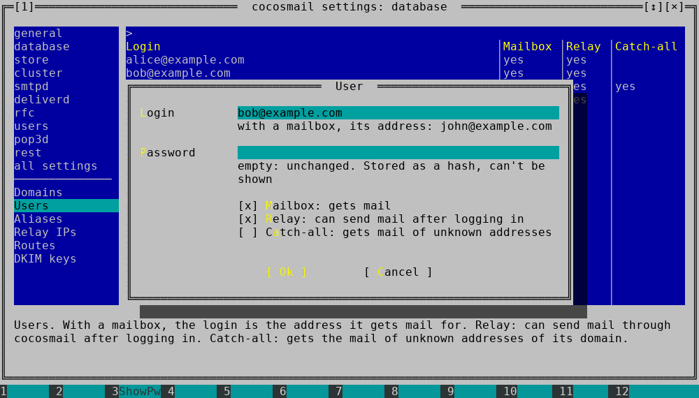

# cocosmail

**An email server for human beings.**



cocosmail is a complete, self-hosted mail server in a single binary. It
receives mail for your domains, delivers it to local mailboxes, lets you read
it over IMAP or POP3 and sends your mail to the rest of the internet. There is no
Postfix + Dovecot + OpenDKIM + queue daemon + database server to glue
together: one program, one folder, and a text UI to set it up.

## Why it's easy

- **One binary, one folder.** The database (SQLite), the queue (nsqd), the
  default files: everything is built in. Everything lives next to the binary.
- **Easy to configure.** `cocosmail config edit` opens a text UI for all
  settings and data: domains, users, aliases, relay IPs, routes and DKIM keys.
  Every setting is described, values are checked before they're accepted, and
  nothing is saved until you press F2 and see what changed. No hand-written
  config files, no `postmap`, no reloads.
- **Changes apply by themselves.** A running server picks up new settings
  within seconds. When a setting needs a restart (listeners, database...),
  cocosmail first checks that it will start with it (certificates, free ports),
  then restarts itself in the same process. If the check fails, it keeps
  running with the old settings and logs why.
- **Easy to back up and move.** Copy the folder to another server and start it.
  Or put everything in one YAML file: `config export` on the old server,
  `config import` on the new one.
- **Easy Docker.** One container, one volume, the config file as the source of
  truth. Users can be added while it runs with `docker exec`.
- **Friendly when something's missing.** Started for the first time in a
  terminal, cocosmail offers to create the database and open the configurator.
  Adding a mailbox in a new domain adds the domain. Errors say what to do.

## What you get

- **SMTP**: receives mail from other servers (MX) and from your mail clients:
  STARTTLS, implicit TLS (SMTPS), `AUTH PLAIN`/`LOGIN`, login only over
  TLS 1.2+.
- **IMAP** with folders (Sent, Drafts, Trash, Junk and Archive are created and
  recognized by mail programs), IDLE (new mail shows up at once), MOVE,
  STARTTLS or TLS. **POP3** over TLS. Both work on the same Maildir at the
  same time, and see each other's changes. Mail can also be delivered by
  Dovecot's LDA.
- **Outgoing mail**: queue with retries and bounces, MX lookup, static routes
  and smarthosts, several local IPs with failover or round robin, STARTTLS,
  **DKIM** signing.
- **Anti-abuse**: SPF checks, optional ClamAV, relay control per IP or per
  user, a fail2ban-style plugin.
- **IPv4 and IPv6** everywhere.
- **Aliases**, forwarding, catch-all, mini mailing lists, piping mail to a
  command.
- **Plugins** in plain Go, loaded at runtime without recompiling.
- SQLite by default, MySQL/MariaDB and PostgreSQL supported. A CLI for
  everything, and a small REST API.

## Quick start

These steps set up `mail.example.com` for the domain `example.com`. Replace
them with your own names.

### 1. Build

You need Go 1.26.6 or newer (an older `go` downloads it) and a C compiler
(SQLite uses cgo):

```sh
git clone https://github.com/stunndard/cocosmail.git
cd cocosmail
go build -tags goffi_static -o dist/cocosmail      # or: task build
```

The `goffi_static` tag is required (the text UI library has an FFI layer that
doesn't link in cgo builds otherwise). A fully static binary, which runs on any
Linux and in minimal containers (needs `libc6-dev` on Debian/Ubuntu):

```sh
CGO_ENABLED=1 go build -trimpath \
  -tags 'netgo osusergo sqlite_omit_load_extension goffi_static' \
  -ldflags '-s -w -linkmode external -extldflags "-static"' \
  -o dist/cocosmail                                # or: task build-static
```

### 2. Install and configure

Run cocosmail as its own user. Only the binary is needed, it writes
everything else itself:

```sh
sudo adduser --disabled-password cocosmail
sudo install -d -o cocosmail /home/cocosmail/mail
sudo install -o cocosmail dist/cocosmail /home/cocosmail/mail/
sudo -iu cocosmail
cd ~/mail
./cocosmail config edit
```

The first `config edit` creates the database and the default files (like
`cocosmail init`, which is safe to run any time, e.g. after an upgrade). In the
text UI:

1. **general**: set `me` to `mail.example.com`.
2. **smtpd**, **imapd**, **pop3d**, **deliverd**: turn on `smtpd_launch`,
   `imapd_launch`, `pop3d_launch` (if you want POP3 too) and `deliverd_launch`.
   The listeners (`smtpd_dsns`, `imapd_dsns`, `pop3d_dsns`) have their own
   editor; a typical public server listens on:
   - 25: mail from other servers (STARTTLS available)
   - 587 (STARTTLS) and 465 (TLS): your mail clients, with login
   - 993: IMAP over TLS (143 with STARTTLS works too)
   - 995: POP3 over TLS
3. **Users**: F7 adds `you@example.com` with a password. Keep **Mailbox**
   (gets mail) and **Relay** (can send mail out after logging in). The domain
   `example.com` is added with it.
4. F2 saves, F10 quits. F1 shows the help.

Prefer files? Copy `conf/cocosmail.yaml.base` (every setting, documented) to
`conf/cocosmail.yaml` and edit it; it's imported at the first start, see
[Settings and data](#settings-and-data). The command line works too:

```sh
./cocosmail config set me mail.example.com
./cocosmail user add -m -r you@example.com 'a-good-password'
```

### 3. Certificates

Each listener names a certificate (`example.com` here). cocosmail loads
`ssl/smtp-example.com.crt`/`.key` for SMTP, `ssl/imap-...` for IMAP and
`ssl/pop3-...` for POP3. With Let's Encrypt:

```sh
sudo certbot certonly --standalone -d mail.example.com
cd /home/cocosmail/mail/ssl
for p in smtp imap pop3; do
  sudo cp /etc/letsencrypt/live/mail.example.com/fullchain.pem $p-example.com.crt
  sudo cp /etc/letsencrypt/live/mail.example.com/privkey.pem   $p-example.com.key
done
sudo chown cocosmail: *.crt *.key && sudo chmod 600 *.key
```

For a test, a self-signed one does too:
`openssl req -x509 -newkey rsa:2048 -nodes -days 365 -subj /CN=mail.example.com -keyout ssl/smtp-example.com.key -out ssl/smtp-example.com.crt`
(and the same for `imap-` and `pop3-`).

### 4. Start

```sh
./run                     # or ./cocosmail
```

```
... smtpd [::]:25 launched.
... imapd [::]:993 SSL launched
... pop3d [::]:995 SSL launched
... deliverd launched
```

cocosmail doesn't need root. To bind ports below 1024, run
`sudo setcap cap_net_bind_service=+ep cocosmail` (again after each rebuild),
or use systemd:

```ini
# /etc/systemd/system/cocosmail.service
[Unit]
Description=cocosmail mail server
After=network-online.target
Wants=network-online.target

[Service]
User=cocosmail
WorkingDirectory=/home/cocosmail/mail
ExecStart=/home/cocosmail/mail/cocosmail
AmbientCapabilities=CAP_NET_BIND_SERVICE
Restart=on-failure

[Install]
WantedBy=multi-user.target
```

```sh
sudo systemctl enable --now cocosmail && journalctl -u cocosmail -f
```

Mail clients: IMAP `mail.example.com:993` (SSL/TLS) or POP3 port 995 (SSL/TLS),
SMTP port 587 (STARTTLS) or 465 (SSL/TLS), login `you@example.com`.

### 5. DNS

| Record                      | Value                                                  |
|-----------------------------|--------------------------------------------------------|
| `mail.example.com` A / AAAA | your server's IPv4 / IPv6 address                      |
| `example.com` MX            | `10 mail.example.com.`                                 |
| `example.com` TXT (SPF)     | `v=spf1 mx -all`                                       |
| DKIM TXT                    | text UI: **DKIM keys**, F7 adds a key, F6 shows the record |
| reverse DNS (PTR)           | `mail.example.com`, set at your hosting provider       |

Then turn on `deliverd_dkim_sign` to sign outgoing mail.

## Docker

The static binary runs in any image. A `Dockerfile`:

```dockerfile
FROM debian:stable-slim
COPY dist/cocosmail /usr/local/bin/cocosmail
WORKDIR /cocosmail
VOLUME /cocosmail
EXPOSE 25 465 587 993 995
# the binary works in its own directory: copied into the volume at each start
CMD cp /usr/local/bin/cocosmail . && ./cocosmail init && \
    exec ./cocosmail --config conf/cocosmail.yaml
```

Put `conf/cocosmail.yaml` and the certificates (`ssl/`) in a directory, then:

```sh
docker build -t cocosmail .
docker run -d --name mail -v /srv/cocosmail:/cocosmail \
  -p 25:25 -p 465:465 -p 587:587 -p 993:993 -p 995:995 cocosmail
docker exec -it mail ./cocosmail config edit      # add users while it runs
```

With `--config`, the settings of the file are loaded at every start, and
`COCOSMAIL_*` environment variables (e.g. `-e COCOSMAIL_ME=mail.example.com`)
override them. Domains and users of the file are imported into an empty
database once; after that they live in the volume and are managed with
`config edit`, and a restart keeps them.

## Back up, move, upgrade

- **The folder is the server.** Stop cocosmail, copy or zip its folder, start
  it anywhere. Paths are relative to the binary.
- **One file for everything:**

  ```sh
  ./cocosmail config export all.yaml             # settings, domains, users, aliases, routes, DKIM keys
  ./cocosmail config import --dry-run all.yaml   # on the new server: show what would change
  ./cocosmail config import all.yaml
  ```

  Password hashes are exported as they are; `export --no-secrets` leaves out
  passwords, keys and secret settings, and importing such a file keeps the
  ones already there.
- **Upgrade:** replace the binary and start it. New settings get their
  defaults, and `cocosmail init` adds new default files without touching yours.
  Config files of older versions (`COCOSMAIL_KEY=value`) are still read;
  `./cocosmail config convert old.cfg conf/cocosmail.yaml` turns them into YAML
  and warns about mistakes the old version ignored.

## Settings and data

cocosmail keeps two things in its database: **settings** (about 50,
documented in `conf/cocosmail.yaml.base`) and **data** (domains, users,
aliases, relay IPs, routes, DKIM keys). Only `db_driver` and `db_source` stay
outside, since they say where the database is (default: SQLite in `db/`).

One YAML file can hold both:

```yaml
settings:
  me: mail.example.com
  smtpd_launch: true
  smtpd_dsns: '[::]:25:mail.example.com:nossl:example.com'
domains:
  - name: example.com
    local: true
users:
  - login: you@example.com
    password: a-good-password   # hashed when imported
    mailbox: true
    relay: true
aliases:
  - alias: sales@example.com
    deliver_to: [you@example.com, partner@elsewhere.net]
```

- **Database mode** (default): the database is the source of truth.
  `conf/cocosmail.yaml`, if present, is imported at the first start. Then use
  `config edit`, `config set KEY VALUE`, `config import`...
- **File mode** (`--config FILE` or `COCOSMAIL_CONFIG`): the file's settings
  are loaded at every start and are read only elsewhere; change the file and
  restart. Its data is imported only into an empty database. Starting once
  without `--config` goes back to database mode.

`config import` checks everything before writing anything: settings not in the
file get their default (`--merge` keeps them), data is added or changed
(`--replace` also deletes what's not in the file).

### Text UI keys

| Key         | Action                                                       |
|-------------|--------------------------------------------------------------|
| F1          | help                                                         |
| Tab         | switch between the sections and the list                     |
| typing      | search the list, Esc clears                                  |
| Enter, F4   | edit (true/false values are switched)                        |
| F7, Ins     | add a domain, user, alias, relay IP, route or DKIM key       |
| F8, Del     | delete an item, or reset a setting to its default            |
| F6          | DKIM keys: the DNS record to publish                         |
| F3          | show or hide secrets                                         |
| F2          | save, after showing what changed                             |
| F10, Esc    | quit (asks about unsaved changes)                            |

`config edit --file FILE` edits a config file instead, without a database, e.g.
to prepare a server offline. `config get`, `set`, `unset` and `list` also take
`--file`.

## Listeners and outgoing IPs

`smtpd_dsns`, `imapd_dsns` and `pop3d_dsns` are listeners separated by `;`, each
`IP:PORT:HOSTNAME:ssl|nossl:CERT`:

```yaml
  smtpd_dsns: '[::]:25:mail.example.com:nossl:example.com;[::]:587:mail.example.com:nossl:example.com;[::]:465:mail.example.com:ssl:example.com'
  imapd_dsns: '[::]:993:mail.example.com:ssl:example.com'
  pop3d_dsns: '[::]:995:mail.example.com:ssl:example.com'
```

- IP: IPv4, IPv6 in brackets (`[2001:db8::10]`, `[fe80::1%eth0]`), or `[::]`,
  `0.0.0.0` or empty for all addresses, IPv4 and IPv6.
- `ssl`: TLS from the start; `nossl`: plain text with STARTTLS, login only after
  it. POP3 has no STARTTLS, so `nossl` is only allowed there on loopback
  (behind a TLS proxy). IMAP on loopback with `nossl` allows login without TLS.

`deliverd_local_ips` are the addresses used to send mail: `&` between them for
failover, `|` for round robin, `:hostname` for a HELO name per address
(`[2001:db8::10]:mail.example.com`). The default `0.0.0.0&::` uses IPv4 and
falls back to IPv6. Routes use the same syntax.

## Mail storage

Each user's mail is a Maildir in `mailboxes/`: INBOX is the user's directory
(`cur/`, `new/`, `tmp/`), folders are `.Sent`, `.Archive.2024`... in it
(Maildir++, the layout Dovecot uses), and flags are in the file names. A
mailbox can be backed up, or brought from another server, by copying the
directory. IMAP UIDs are kept in `cocosmail-uidlist` in each folder.

## Command line

`./cocosmail help` and `./cocosmail <command> help` show everything.

| Command    | Purpose                                                              |
|------------|----------------------------------------------------------------------|
| `init`     | write missing default files, create database tables (safe to repeat) |
| `config`   | `edit`, `list`, `get`, `set`, `unset`, `import`, `export`, `convert`  |
| `rcpthost` | domains cocosmail accepts mail for                                   |
| `user`     | users, mailboxes, catch-all                                          |
| `alias`    | aliases, forwarding, pipe to command                                 |
| `relayip`  | IPs allowed to send without login                                    |
| `routes`   | static routes, e.g. a smarthost                                      |
| `dkim`     | DKIM keys and DNS records                                            |
| `queue`    | outgoing queue: list, discard, bounce, purge                         |

```sh
# send all mail for example.net through a smarthost
./cocosmail routes add -d example.net -rh smtp.provider.net -rp 587 -rl login -rpwd password
```

## Plugins

Plugins are Go source files in `plugins/<name>/<name>.go`, interpreted at
runtime by [yaegi](https://github.com/traefik/yaegi): no Go toolchain needed on
the server. They hook into the SMTP session (`connect`, `helo`, `mailpre`,
`mailpost`, `rcptto`, `data`, `beforequeue`, `quit`, `exitasap`, `auth`), and
`plugins/config.go` enables them. Included: `fail2ban` (bans IPs after failed
logins, on by default) and `customgreeting` (an example).

## More

[TODO.md](TODO.md) has plans and known issues, [CHANGELOG](CHANGELOG) the
history. Issues and pull requests are welcome; feedback on what was hard to
set up is especially useful, since easy setup is the point of this project.

cocosmail started as [tmail](https://github.com/toorop/tmail) by Stéphane
Depierrepont (Toorop). MIT license, see [LICENSE](LICENSE).
